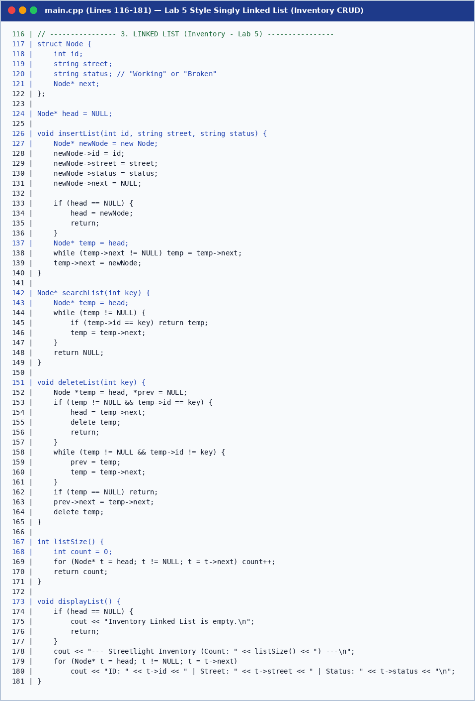
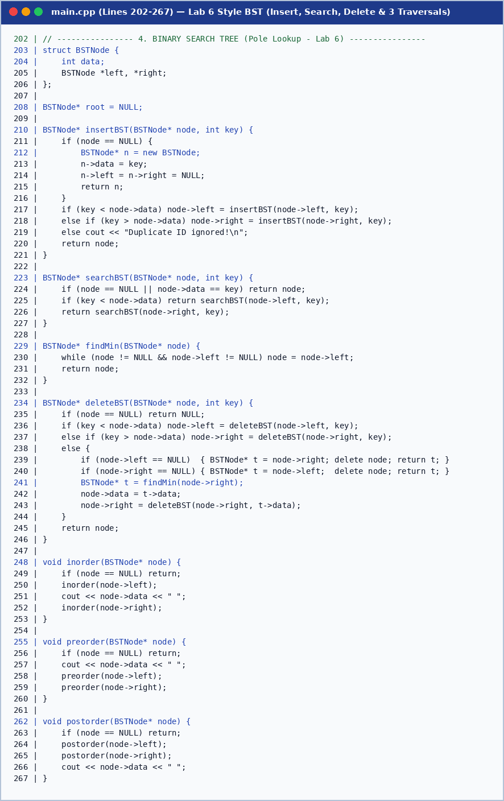
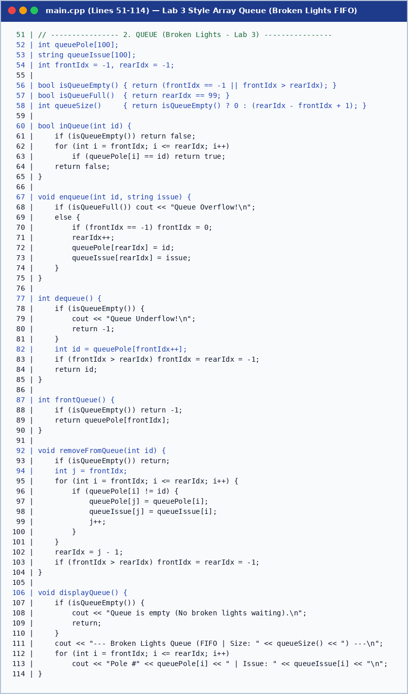
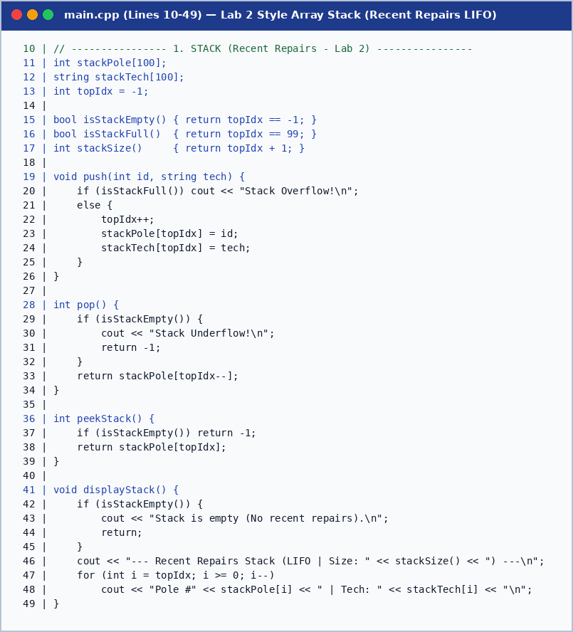
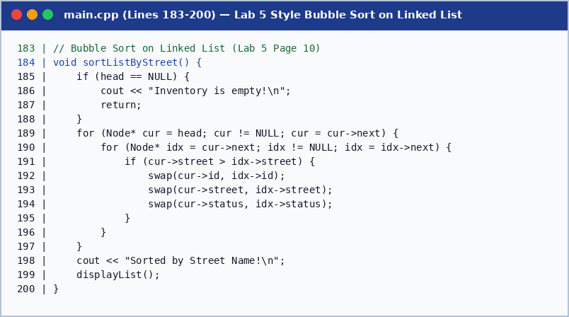
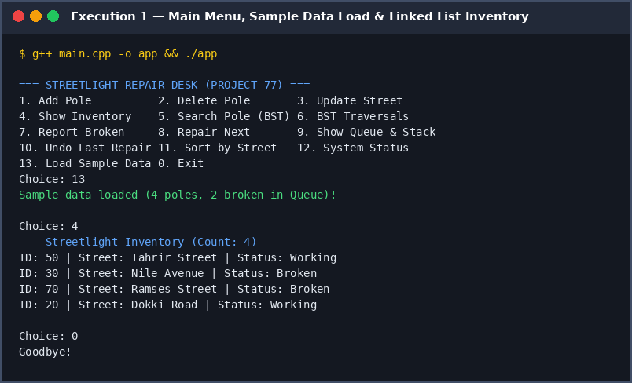
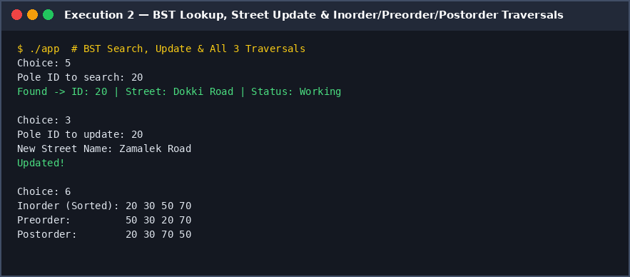
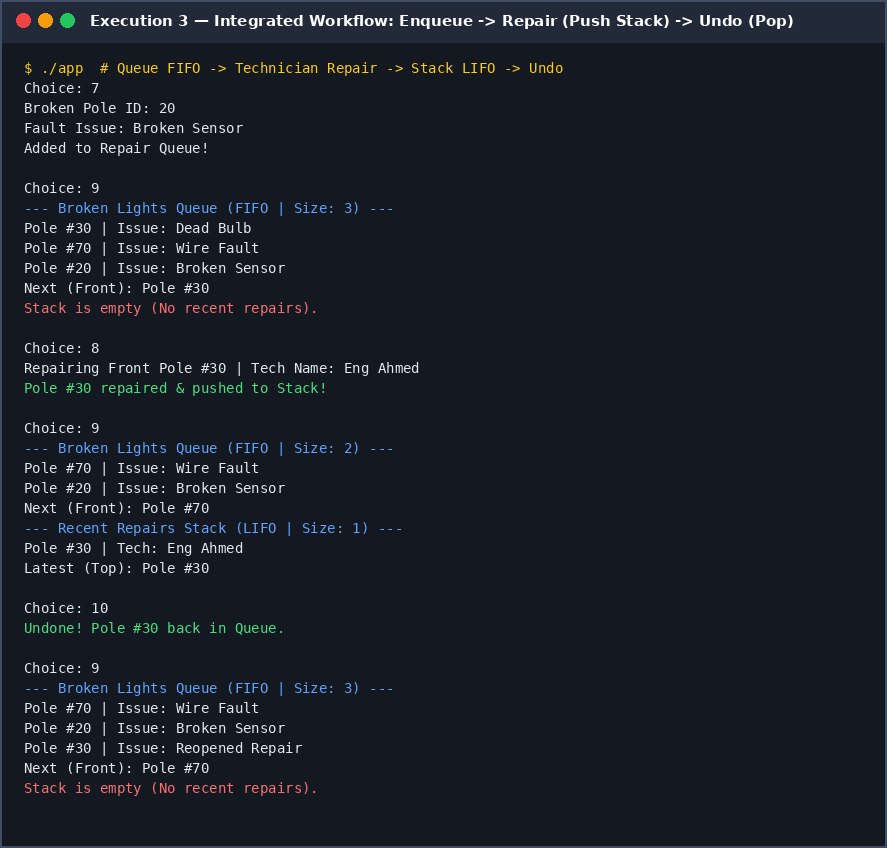
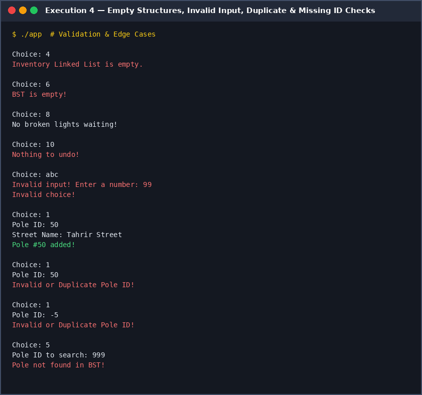
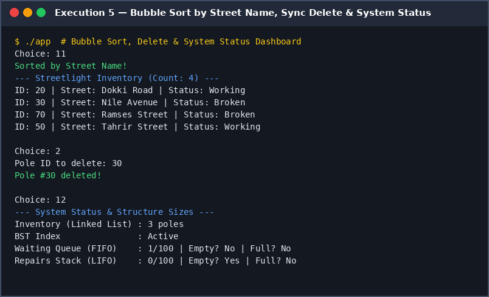

# CS212 – Data Structures Course Project
## Project #77: Streetlight Repair Desk

  

An integrated, menu-driven C++ console application for managing streetlight poles and repair dispatch — implementing **Stack, Queue, Singly Linked List, Binary Search Tree (BST), and Bubble Sort 100% manually** (CS212 Labs 2–6 style, without `std::stack`, `std::queue`, `std::list`, `std::map`, or ready-made tree structures).

**Registered Practical Section:** CRN 7182  
**Team ID:** Team 77

### Team Members (CRN: 7182)

| # | Name | ID |
|---|------|----|
| 1 | Mohamed Ahmed Abdelkhalek Gohary | `200038102` |
| 2 | Yusuf Ahmed Muhammad Sayed | `200067726` |
| 3 | Bilal Mahmoud Fahmy Mahmoud | `200069114` |
| 4 | Abdelrahman Salah Ibrahim Abdelwahab | `200070046` |
| 5 | Abdul-Azim Ibrahim Abdul-Azim Ibrahim Jabr | `200073612` |
| 6 | Hamza Abdelfattah Elazab Fayad | `200083256` |

---

## 1. Data Structures Used

| Structure | Implementation | Lab | Purpose in the System |
|-----------|----------------|-----|-----------------------|
| **Stack** | `stackPole[100]`, `topIdx` | Lab 2 | Recent completed repairs (**LIFO**) + Undo / Reopen last repair |
| **Queue** | `queuePole[100]`, `frontIdx`, `rearIdx` | Lab 3 | Broken streetlights awaiting technicians (**FIFO**) |
| **Singly Linked List** | `struct Node* head` | Lab 5 | Dynamic streetlight inventory (`id`, `street`, `status`) |
| **Binary Search Tree** | `struct BSTNode* root` | Lab 6 | Unique Pole ID index — `insertBST`, `searchBST`, `deleteBST`, and traversals. BST operations are O(log n) when balanced and O(n) in the worst case; displaying a full record also scans the Linked List. |
| **Bubble Sort** | `sortListByStreet` | Lab 5 | Sort the Linked List alphabetically by Street Name |

Updates are applied to the structures that hold or schedule each pole: adding a pole updates the Linked List and BST; deleting it also removes any waiting Queue entry; reporting, repairing, and undoing a repair keep the pole status and Queue/Stack workflow in sync. The Stack stores repair history, so a deleted pole may still appear there until its history entry is handled. The Queue is a linear array: once its rear reaches the last slot, earlier unused positions are not reused until the Queue becomes empty.

## 2. Menu Options

| Choice | Action | Choice | Action |
|--------|--------|--------|--------|
| `1` | Add Pole | `8` | Repair Next (dequeue → push to Stack) |
| `2` | Delete Pole (sync delete) | `9` | Show Queue & Stack |
| `3` | Update Street | `10` | Undo Last Repair (pop → re-enqueue) |
| `4` | Show Inventory | `11` | Sort by Street (Bubble Sort) |
| `5` | Search Pole (BST) | `12` | System Status |
| `6` | BST Traversals | `13` | Load Sample Data |
| `7` | Report Broken (enqueue) | `0` | Exit |

## 3. Project Layout

```text
Data-Structures_Project/
├── README.md
├── Makefile
├── build.bat                 ← Windows: double-click to build .exe & run
├── build.sh                  ← Linux/macOS: one-click build & run
├── .gitignore
├── .vscode/                  ← VS Code Run button config
│   ├── tasks.json            ← Windows builds Source_Code/main.exe; Linux builds streetlight_app
│   ├── launch.json           ← Run/Debug config (F5 / Ctrl+F5)
│   ├── c_cpp_properties.json ← IntelliSense (C++17)
│   └── settings.json         ← C/C++ Runner settings (optional)
├── Source_Code/
│   ├── main.cpp
│   └── main.exe                ← Windows executable; rebuilt from main.cpp by build.bat
├── Report/
│   └── CS212_Project_77_Streetlight_Repair_Desk_Report.docx
├── Screenshots/
│   ├── code_01_linked_list.png
│   ├── code_02_bst.png
│   ├── code_03a_queue.png
│   ├── code_03b_stack.png
│   ├── code_04_bubble_sort.png
│   ├── exec_01_menu_and_inventory.png
│   ├── exec_02_bst_lookup_traversals.png
│   ├── exec_03_integrated_queue_stack_undo.png
│   ├── exec_04_validation_edge_cases.png
│   └── exec_05_sorting_and_sync_delete.png
└── Tests/
    ├── test_cases_documentation.md
    └── sample_demo_input.txt
```

## 4. How to Compile and Run

### Using `g++` (Linux / macOS / Windows MinGW)

```bash
g++ -std=c++17 Source_Code/main.cpp -o streetlight_app
./streetlight_app
```

> On Windows Command Prompt / PowerShell, run `streetlight_app.exe`.

### Using `make`

```bash
make          # build
make run      # build + run interactively
make demo     # build + run the automated demo script
make clean    # remove build artifacts
```

### Using VS Code (Run button ▶ / F5)

The repo ships with a ready-made `.vscode/` config, so the Run button works out of the box:

1. **Install prerequisites (once):**
   - Extension **C/C++** (Microsoft) — and optionally **C/C++ Runner**
   - A C++ compiler: on Windows install **MinGW-w64** and add its `bin` folder to `PATH`
   - Verify in the VS Code integrated terminal (`Ctrl + \``): `g++ --version`
2. **Open the folder, not just the file:** `File > Open Folder` → select `Data-Structures_Project`
3. **Press the Run button:** open the **Run and Debug** panel (left sidebar ▶) and click ▶, or press `F5` (Debug) / `Ctrl+F5` (Run without Debug — best for this menu app).
   - `tasks.json` builds `Source_Code/main.exe` on Windows or `streetlight_app` on Linux/macOS, then `launch.json` runs the matching output. On Windows, every Run/Debug build refreshes the tracked executable from `Source_Code/main.cpp`.
4. **Get a standalone executable:** double-click **`build.bat`** on Windows; it rebuilds `Source_Code/main.exe` from the current source and runs it. On Linux/macOS, run `./build.sh`; it builds and runs `streetlight_app`. Do not expect an existing executable to update merely because `main.cpp` changed—run the build command first.

> **Troubleshooting**
> | Symptom | Fix |
> |---|---|
> | `g++ is not recognized` | MinGW not in `PATH` — add its `bin` folder to PATH and restart VS Code |
> | `launch.json` / Run button missing | Open the **folder** (`File > Open Folder`), not a single file |
> | `program not found` / `.exe` missing | Run the `build` task first (`Terminal > Run Build Task`) or press `F5` (it builds automatically via `preLaunchTask`) |
> | IntelliSense red squiggles but it compiles | Check `g++ --version` works; `.vscode/c_cpp_properties.json` uses `g++` from `PATH` — if your MinGW is elsewhere, set `compilerPath` to its full path (e.g. `C:/MinGW/bin/g++.exe`) |

### Using another IDE (Code::Blocks / Dev-C++ / Visual Studio / CLion)

1. Open `Source_Code/main.cpp` in a C++ Console Application project.
2. Click **Build and Run**.

### Automated Demo Script

To reproduce the tested end-to-end workflow automatically:

```bash
./streetlight_app < Tests/sample_demo_input.txt
# or
make demo
```

## 5. Screenshots

### Code Screenshots

| Linked List | BST |
|-------------|-----|
|  |  |

| Queue | Stack |
|-------|-------|
|  |  |

| Bubble Sort |
|-------------|
|  |

### Execution Screenshots

| Menu & Inventory | BST Lookup & Traversals |
|------------------|-------------------------|
|  |  |

| Queue / Stack / Undo | Validation & Edge Cases |
|----------------------|-------------------------|
|  |  |

| Sorting & Sync Delete |
|-----------------------|
|  |

## 6. Tests

Test matrix, scenarios, results, complexity notes, and known limits: [`Tests/test_cases_documentation.md`](Tests/test_cases_documentation.md)

| Test | Category | Result |
|------|----------|--------|
| TC-01 | Normal CRUD (load sample data + inventory) | ✅ PASS |
| TC-02 | BST lookup & 3 traversals | ✅ PASS |
| TC-03 | Empty structures (safe, no crash) | ✅ PASS |
| TC-04 | Boundary & single item | ✅ PASS |
| TC-05 | Invalid & duplicate data (`abc`, `99`, `-5`, `999`) | ✅ PASS |
| TC-06 | Integration: Repair dispatch (FIFO → LIFO) | ✅ PASS |
| TC-07 | Integration: Undo repair | ✅ PASS |
| TC-08 | Integration: Sync delete (List + BST + Queue) | ✅ PASS |
| TC-09 | Sorting (Bubble Sort by street) | ✅ PASS |
| TC-10 | Stack and Queue full-capacity handling | ✅ PASS |
| TC-11 | Undo with duplicate or deleted pole; EOF handling | ✅ PASS |

## 7. Report

The full project report is available at: [`Report/CS212_Project_77_Streetlight_Repair_Desk_Report.docx`](Report/CS212_Project_77_Streetlight_Repair_Desk_Report.docx)
